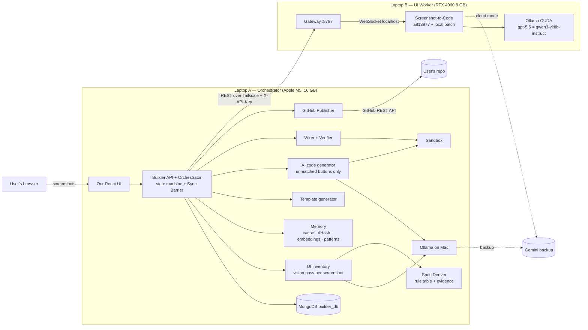
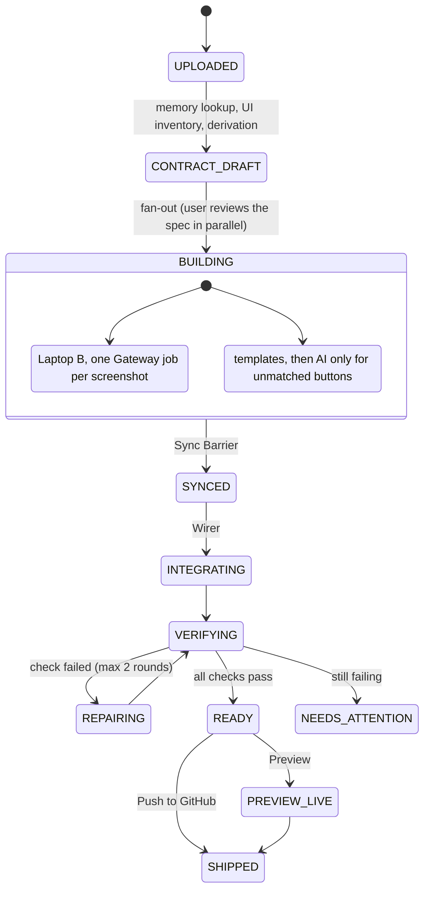

# Architecture v3.1: Screenshots → Exactly the App They Show → User's GitHub

> **One-line summary:** The user uploads **screenshots** of a UI. We read every visible element into a **UI inventory**, and derive from it an **App Spec** containing **only what the screens need to work**: if there is a table, there is a list endpoint; if there is no login screen, there is no auth. Every spec item carries its **evidence** (which element on which screenshot requires it). **Both laptops build against that same App Spec**: Laptop B builds each page from its screenshot (Screenshot-to-Code, GPU), and Laptop A generates the backend from **templates**, using an **AI code model only for buttons no template can handle**. A **Sync Barrier** waits until everything is built for the *same* spec version. Then we **wire, verify, preview** and **push a working app to the user's GitHub**. Repeats and similar screenshots reuse verified work.

**Status:** v3.1, approved 16 Oct 2026 · Phase 1 of AndarKaCode (screenshot-only) · Replaces v3 and v2 · Related: [plan.md](plan.md)

---

## 0. The guiding rule: no evidence, no code

> **Every backend component must be traceable to a visible UI element. Every visible interactive element must be backed by a working component.**

| The screenshot shows | We build | We do **not** build |
|---|---|---|
| A table of employees with Edit/Delete | list, update, delete for `employee` | create (no Add button), login, roles, stats |
| The same, plus "Add Employee" and a search box | + create + validation + search | pagination (not shown), auth |
| A login form | users, `POST /auth/login`, token, protected routes | registration (no sign-up link), roles (none visible) |
| Cards "Total: 42 · Pending: 5" | one stats endpoint with exactly those two numbers | charts or reports that aren't on screen |
| An "Approve" button on each row | one approve operation | approval history, notifications |

Two checks enforce this rule automatically (§8): **every frontend control has a working endpoint**, and **every generated endpoint is used by some control**.

**Phase 1** (this document) is screenshot-only. Text requests ("also email the manager"), extra features and chat-style refinement are **Phase 2** of AndarKaCode, and the design leaves room for them (§16).

---

## 1. The core ideas

1. **UI inventory first.** A vision pass lists what each screenshot contains: tables and their columns, forms and their inputs, buttons and where they sit, search and filter boxes, pagination, badges, stat cards, login forms, navigation. It describes *what is there*, not what the app should do.
2. **Derivation rules, not guessing.** A deterministic rule table (§4) maps each kind of element to the backend parts it needs. Ambiguities become short **open questions**, not assumptions.
3. **The App Spec (Contract) is the single source of truth**, and every item carries its evidence. Frontend, backend, tests and wiring are all generated from it; every artifact is stamped with its hash.
4. **The Sync Barrier.** Integration starts only when every page and the whole backend carry the current spec hash (verified in Step 9).
5. **Laptop A orchestrates, Laptop B works.** A owns all state and always initiates calls; B is a stateless worker behind one Gateway.
6. **Templates first, AI only where no template fits.** Standard elements (tables, forms, search, badges, status buttons, stat cards, login) map to tested templates. A button whose meaning no template covers is the only thing an AI code model writes, and it ships only if its tests pass.
7. **Ship only what passed verification**, and **remember verified work** for repeats and similar screenshots.

---

## 2. The big picture



---

## 3. The build lifecycle (state machine)



| Step | Where | What happens | Measured / expected |
|---|---|---|---|
| 1. Upload | A | Hash each screenshot (SHA-256 + perceptual dHash), shrink to ≤ 1280 px, store | instant |
| 2. Spec | A | **Memory lookup** (§9); **UI inventory** per screenshot (vision); **derivation** (rules, no AI); open questions for real ambiguities | 15–20 s per screenshot (measured for the current extractor) |
| 3a. Pages | **B** | One Gateway job per screenshot, with instructions generated from that page's part of the spec | ~2–3 min per page locally (measured), ~30 s cloud |
| 3b. Backend | A | Templates (ms); AI only for unmatched buttons (tests + repair each) | target < 1 min per AI piece |
| 3c. Review | User | Sees each spec item with its evidence; can correct types, options, enum-vs-relation, or remove an item | parallel |
| 4. Barrier | A | Proceed only if every artifact has the current spec hash | instant (verified) |
| 5–7. | A | Wire, verify, preview / push | under a minute |

Spec edits during a build create a new version; the Barrier refuses anything built for the old one (verified in Step 9). Each entity and operation has its own sub-hash, so an edit only rebuilds what it touches.

---

## 4. From screenshot to App Spec

### 4.1 UI inventory (vision pass, one per screenshot)

Structured output (JSON Schema), describing only what is visible:

```jsonc
{
  "screen": { "title": "Employee Management", "kind": "list" },          // list | form | dashboard | login | detail
  "tables": [ { "id": "t1", "columns": ["Full Name", "Email", "Department", "Salary", "Status"],
                "sampleRows": [["Ann Lee", "ann@x.com", "HR", "52,000", "Active"]],
                "rowActions": ["Edit", "Delete", "Approve"] } ],
  "forms": [ { "id": "f1", "inputs": [ { "label": "Full Name", "kind": "text", "requiredMark": true },
                                       { "label": "Department", "kind": "select", "options": ["HR", "Engineering"] } ],
               "submit": "Save" } ],
  "buttons": [ { "label": "Add Employee", "scope": "page" } ],
  "search": true, "filters": [ { "label": "Department", "options": ["All", "HR", "Engineering"] } ],
  "pagination": { "visible": true, "text": "Showing 1–10 of 42" },
  "statCards": [ { "label": "Total Employees", "value": "42" } ],
  "auth": { "loginForm": false, "signupLink": false, "userMenu": false, "roleIndicators": [] },
  "navigation": ["Employees", "Departments"]
}
```

### 4.2 Derivation rules (deterministic)

| UI element (evidence) | Spec item → backend component | Default when not shown |
|---|---|---|
| Table columns + sample values | entity fields; type from values (email, date, number, currency → number, Yes/No → boolean) | — |
| Badge column with a few values | `enum` field with those options | — |
| Row-level Edit | `GET /:id`, `PUT /:id` | not built |
| Row-level Delete / trash icon | `DELETE /:id` (hard) | not built |
| "Archive" / "Restore" / "Deleted" tab | soft delete + restore | hard delete |
| "Add X" button or empty form | `POST` + validation (`*` marks → required) | not built |
| Search box | `?q=` over text fields | not built |
| Filter dropdown | `?<field>=` filter | not built |
| Pagination / "1–10 of 42" | `page`, `limit`, `total` | return all (capped) |
| Sortable headers (arrows) | `?sort=` | fixed order |
| Stat card ("Total", "Pending") | one `GET /stats` returning exactly those numbers (count / sum / count-by-status) | not built |
| Chart (e.g. per department) | group-by aggregate for that chart only | not built |
| Dropdown whose options are records shown in **another screenshot's table** | `ref` relation + populate | — |
| Dropdown with fixed options and no page for them | `enum` | — |
| Row button matching a status value ("Approve" ↔ `approved`) | **template**: status-transition operation | — |
| Row/page button with no template pattern ("Recalculate", "Duplicate") | **AI**: custom operation | — |
| "Export CSV" | **template**: export endpoint | not built |
| Login form | users + `POST /auth/login` + token + protected routes + a seeded first user | **no auth at all** |
| Sign-up link/form | `POST /auth/register` | not built |
| User menu / Logout | `GET /auth/me`; logout clears the token | not built |
| Role badges / "Admin" labels / role column | `role` on users; role checks only on elements shown as restricted | no roles |
| Static text, images, nav links | nothing on the backend | — |

If the rules can't decide (for example a Department dropdown with no Departments screen: fixed list or managed data?), the spec gets an **open question** with a sensible default (fixed list), and the user can change it during review.

### 4.3 App Spec (Contract v3) with evidence

```jsonc
{
  "app": { "name": "employeeManagement", "label": "Employee Management" },
  "entities": [
    { "name": "employee", "plural": "employees", "label": "Employees",
      "fields": [
        { "name": "fullName", "label": "Full Name", "type": "string", "required": true,
          "evidence": "s1: column 'Full Name', form input marked *" },
        { "name": "status", "label": "Status", "type": "enum", "options": ["pending", "approved", "rejected"],
          "evidence": "s1: badge column 'Status'" } ],
      "endpoints": {
        "list":   { "search": true, "pagination": true, "evidence": "s1: table, search box, 'Showing 1–10 of 42'" },
        "create": { "evidence": "s1: button 'Add Employee'" },
        "update": { "evidence": "s1: row action 'Edit'" },
        "delete": { "soft": false, "evidence": "s1: row action 'Delete'" } } } ],
  "operations": [
    { "name": "approveEmployee", "entity": "employee", "kind": "setStatus", "set": { "status": "approved" },
      "button": "Approve", "evidence": "s1: row action 'Approve'" } ],
  "stats": [],
  "auth": null,
  "pages": [ { "screenshot": 1, "entity": "employee", "kind": "list" } ],
  "openQuestions": []
}
```

`operations[].kind` is `setStatus` or `export` (templates) or `custom` (AI). `auth` is `null` unless a login screen is in a screenshot.

---

## 5. Laptop B: UI Worker (RTX 4060 8 GB) — built and verified (Steps 1–7)

- **Ollama (CUDA)**: `gpt-5.5` = `qwen3-vl:8b-instruct`, `num_ctx` 16384, temperature 0.5; flash attention, `q8_0` KV cache, keep-alive forever, one model loaded. Measured **78% GPU** (Windows keeps ~1 GB VRAM), 29.6 tokens/s.
- **Screenshot-to-Code** at `a813977` with a local patch ([docs/s2c-local.patch](docs/s2c-local.patch)): 1 variant, Windows fixes, retry without `reasoning` for Ollama, Gemini 503 retry, **max 6 agent steps**. **No keys in its `.env`**; the Gateway passes them per request. After patching, restart it manually (auto-reload hangs on Windows).
- **Gateway** ([gateway/](gateway/)): listens only on Laptop B's Tailscale address; `X-API-Key`; one job at a time; the same (image, specHash) returns the same job; `local` / `cloud` / `auto`; takes the last complete page 60 s after `</html>` appears.
- Start everything with [scripts/start-laptop-b.ps1](scripts/start-laptop-b.ps1).

| Method | Path | Body / Result |
|---|---|---|
| `POST` | `/v1/generations` | `{ image, instructions, contractHash, type: "create", mode }` → `202 { jobId }` (`200` for a known request) |
| `GET` | `/v1/generations/:id` | `{ status, progress, chars, provider, contractHash, finishedEarly?, html?, error? }` |
| `GET` | `/v1/health` | `{ s2cUp, ollamaUp, models: [{ name, gpu }], queueLength, cloudAvailable }` |
| *planned* `POST` | `/v1/generations/:id/cancel` | stop a job for an outdated spec |

Measured: **104–194 s per page locally**. With instructions generated from the spec (exact example button), the local model now includes every marker, including `data-action="create"`.

---

## 6. Laptop A: Orchestrator (M5, 16 GB)

| Component | Job | AI? |
|---|---|---|
| **Builder API + Orchestrator** | State machine, MongoDB as source of truth, resume after restart, polls B every 2 s, Sync Barrier (built in Steps 8–9) | No |
| **UI Inventory** | Vision pass per screenshot → inventory JSON (§4.1), schema-checked | Yes |
| **Spec Deriver** | Rule table (§4.2) → App Spec with evidence; merges screenshots (same entity on two pages; relations between pages) | No |
| **Template generator** | Spec → only the components the spec lists | No |
| **AI code generator** | Only `custom` operations → `custom/*.js` + tests; safety check; sandbox; repair loop | Yes |
| **Memory** | Exact cache, image dHash, spec embeddings, pattern library (§9) | Embeddings only |
| **Wirer** | Runtime binder `app.js` + `api-map.json` per page | No |
| **Verifier** | Checks in §8, including the evidence checks | No |
| **Sandbox** | Runs generated tests and previews (§10) | No |
| **GitHub Publisher** | New repo, one commit, CI | No |

**Models on the Mac (Ollama), one loaded at a time to fit 16 GB:** vision `qwen3-vl:8b-instruct` (measured 15–20 s; cloud backup `gemini-3-flash-preview`, measured 9.6 s); a coding model for `custom` operations (chosen in Step 13's spike, e.g. `qwen2.5-coder:7b`; cloud backup Gemini); a small embedding model for memory (e.g. `nomic-embed-text`).

**Provider Router:** local first; on error, timeout, or output that fails its schema/tests → cloud if a key and budget remain, else `NEEDS_ATTENTION`. "Demo mode" forces cloud. Every artifact records its provider. Gemini's free tier allows **20 requests/day per model** (measured); the demo needs billing or a warm cache.

---

## 7. The backend generator

```
App Spec ──▶ Template generator ──▶ only what the spec lists:
             │                       models (+ relations) · validation · list (+ search / filter / page / sort)
             │                       · get · create · update · delete (hard or soft) · setStatus ops · export
             │                       · stats · auth (only if a login screen) · server · tests for each part
             │
             └─▶ AI code generator ─▶ custom/operations/<name>.js + tests     (only for `custom` operations)
                       │
                 safety check (AST) ─▶ sandbox test run ─▶ pass → keep
                       │ fail
                 repair: error + code back to the model (max 3 tries, then cloud)
                       │ still failing
                 that endpoint answers 501 "needs attention"; everything else works
```

**Templates are composable building blocks**, each emitted only when the spec contains it. An employees table with only Edit/Delete produces a model, `GET /`, `GET /:id`, `PUT /:id`, `DELETE /:id`, the validation for update, and tests for exactly those routes. Nothing else.

**AI code boundaries** (for `custom` operations only):
- **Fixed signature:** `export default async function ({ params, body, models, errors }) { … return { status, body } }`. The template layer generates the route that calls it; the AI never touches routing, auth or the database connection.
- **Context given:** the button label and where it sits, the entity's generated model code, the helper API.
- **Safety check before running:** parse with `acorn`; reject `import`/`require`, `process`, `eval`, `Function`, `fetch`, timers and anything outside the allowlist (screenshot text could try to steer the model).
- **Tests decide:** the model writes tests from the operation's meaning, using generated fixtures; the code ships only if all tests pass in the sandbox.

**API shape** (what the binder relies on): `GET /api/<plural>` → `{ items, total }` (`page`/`limit`/`q`/filters/`sort` only if the spec has them); records use `id`, never `_id`; relations come populated as `{ id, label }`; errors are `400 { error, details: { field: message } }`, `401`, `404`, `409` (duplicate), `501` (operation not available).

---

## 8. Verify before shipping

| # | Check | How | If it fails |
|---|---|---|---|
| 1 | **Pages match the spec** | Headless browser: after the page's own scripts run, every field has `data-field` and every endpoint/operation has its `data-action` (some models add markers with JavaScript) | Repair: Gateway `update` job for the missing markers (max 2), then cloud |
| 2 | **Every control is backed** | Each `data-action` / `data-field` in the pages maps to an endpoint in `api-map.json` | Generator bug → fix; or the spec missed an element → re-derive |
| 3 | **Nothing unnecessary** | Each generated endpoint is used by at least one control; each spec item has evidence | Remove the unused component |
| 4 | **Backend boots + template tests** | Sandbox; `GET /health`; generated tests for exactly the listed parts | Template bug → fix the template |
| 5 | **AI code tests** | Per `custom` operation, in the sandbox | Repair loop (§7) |
| 6 | **End-to-end smoke** | Playwright: use every visible control once (add, edit, search, the status button, log in if present) | `NEEDS_ATTENTION` with a screenshot |

Only `READY` projects can be previewed or pushed.

---

## 9. Memory: cache and similarity

| Level | Key | What is reused |
|---|---|---|
| **Exact repeat** | screenshot SHA-256; spec hash; per-entity / per-operation sub-hash | UI inventory, pages (Gateway cache, verified), template output, verified AI code |
| **Near-duplicate screenshot** | 64-bit perceptual **dHash**, Hamming distance ≤ 6 | the earlier inventory and spec as a starting point ("looks like *Employee Management*") |
| **Similar content** | embedding of the inventory (titles, columns, buttons), stored in MongoDB, cosine similarity | suggest the earlier spec's decisions (types, enum vs relation) |
| **Pattern library** | embedding of a `custom` operation's button + context | **verified** code offered to the AI generator first; it must still pass the new app's tests |

Only verified artifacts enter memory. Memory never adds features: a reused spec is still filtered through the current screenshot's evidence.

---

## 10. Sandbox (tests and preview)

| Rule | Why |
|---|---|
| Docker on Laptop A (OrbStack or Docker Desktop); app + its own MongoDB on a private network, **no internet** | Generated code can't reach `builder_db`, the network or the laptop |
| 512 MB memory per container, 1 CPU, non-root, read-only filesystem, time limit per test run | Runaway code can't take over the laptop |
| **No secrets inside** | Nothing to steal |
| Previews on a separate port/origin (e.g. `:7100`), auto-stop after 30 min, one at a time | Generated JS can't read our UI's cookies; 16 GB is shared with Ollama |

Needed from Step 13 (the first AI-written code); templates-only backends are tested the same way.

---

## 11. Push to the user's GitHub

- **"Sign in with GitHub"** (OAuth App) is our product's own login, unrelated to the generated app's auth. Scopes: `read:user` at login; `public_repo` (or `repo`) + `workflow` only on first publish. Tokens encrypted with AES-256-GCM, only on Laptop A.
- Push via the REST API: create a **new** repo → blobs → tree → commit → `refs/heads/main`. CI runs the generated tests.

**What the user receives** (example: one employees screenshot with Add, Edit, Delete, search and an Approve button; no login screen):

```
employee-management/
├── README.md              how to run; each feature and the screenshot element it came from
├── app-spec.json          the agreed spec (version + hash + evidence)
├── docker-compose.yml     app + mongo
├── .env.example           MONGODB_URI, PORT  (JWT_SECRET only if there is a login screen)
├── frontend/
│   ├── index.html         from the screenshot (Screenshot-to-Code), wired
│   ├── app.js             runtime binder (ours)
│   └── api-map.json       which data-action calls which endpoint
├── backend/
│   ├── server.js
│   ├── models/employee.model.js
│   ├── validation/employee.validation.js
│   ├── controllers/employee.controller.js   list(q, page) · get · create · update · delete · approve
│   └── routes/employee.routes.js
├── tests/                 one test per generated endpoint + smoke.spec.js
└── .github/workflows/ci.yml
```

No `auth/` folder, no users, no stats: none of them were on the screen.

---

## 12. Our database (`builder_db` on Laptop A)

| Collection | Key fields |
|---|---|
| `users` | `githubId`, `login`, `avatarUrl`, `tokenEncrypted`, `scopes` (our product's users) |
| `projects` | `userId`, `name`, `screenshots[] {path, sha256, dHash, inventory}`, `state`, `mode`, `currentContractVersion`, `error` |
| `contracts` | `projectId`, `version`, `hash`, `body` (App Spec with evidence), `subHashes`, `approved`, `answers` |
| `jobs` | `projectId`, `kind: inventory\|frontend\|backend\|operation\|verify\|preview\|publish`, `status`, `provider`, `contractHash`, `remoteJobId`, `artifactPath`, `attempts`, `error`, timestamps |
| `memory` | `kind: screenshot\|spec\|operation`, `key`, `dHash`, `embedding`, `verified`, `sourceProjectId`, `payload` |

> This database holds **our product's** data. Each generated app has its **own** database, set in its own `.env`.

---

## 13. Risks

| Risk | Level | Mitigation |
|---|---|---|
| The vision pass misreads an element (misses a button, wrong type) | **High** | Structured inventory; evidence shown in review; user corrects; check 2 catches controls without endpoints |
| Rules guess wrong on enum vs relation | Medium | Open question with a default; relation only when the other entity has its own screen |
| A 7B local coding model writes wrong `custom` code | Medium (rarely used now) | Templates cover common buttons; tests decide; repair loop; cloud backup; pattern library; 501 isolation |
| Prompt injection via screenshot text | Medium | AST allowlist, sandbox without network or secrets |
| Mac memory: vision + coder + embeddings + MongoDB + Docker in 16 GB | Medium | One model loaded at a time; sandbox limits |
| Local UI model misses markers or keeps editing | Medium (measured) | Generated instructions, 60 s finish rule, max 6 agent steps, repair loop |
| Spec edit during a page build waits for the stale page (~2 min) | Low (measured) | Gateway cancel endpoint |
| Gemini free tier: 20 requests/day per model | Medium (measured) | Local-first, cache, billing for demo day |

---

## 14. Build plan

See [plan.md](plan.md). Steps 1–9 (Laptop B, Gateway, link, Builder API, state machine, Barrier) are **done and verified**. Remaining:

| # | Step | Done when |
|---|---|---|
| 10 | **UI inventory + Spec Deriver** (with a set of test screenshots) | Each test screenshot gives a spec containing exactly its elements, with evidence; the employees screenshot still reaches `SYNCED` |
| 11 | **Template layer** (entities, relations, each endpoint as a building block, setStatus, export, stats, tests) | Backends for every test screenshot contain only their listed parts and pass their tests |
| 12 | **Login templates** (used only when a login screen is present) | A login screenshot gives working login + protected routes; screenshots without one give no auth code |
| 13 | **AI layer for `custom` buttons** (model spike, safety check, Docker sandbox, repair, 501) | A custom button is generated and passes; a broken case is repaired or isolated |
| 14 | **Memory** | A repeat is instant; a near-duplicate screenshot reuses the earlier spec |
| 15 | **Wirer** (binder + `api-map.json`, multiple pages, token if login) | Every control on every page works against the backend |
| 16 | **Verifier + repair** | Checks 1–6 pass, including "every control backed" and "nothing unnecessary" |
| 17 | **React UI** | Upload screenshots, review the spec with evidence, live status, download |
| 18 | **Preview** | Sandboxed preview works and auto-stops |
| 19 | **GitHub publish** | New repo with green CI |
| 20 | **Demo rehearsal** | Full run in under 5 minutes; warm cache; backup video |

**Cut line for a working prototype: Steps 10–17.**

---

## 15. Demo-day runbook

1. The day before: run every demo project once so the cache is warm (and Gemini billing is on, if used).
2. Laptop B: `scripts/start-laptop-b.ps1`; Mac: MongoDB, Ollama, Builder API; check `/api/health`.
3. Flow: upload a list screenshot → the spec appears, each item with its evidence → note what was *not* built (no login on screen, so no auth) → pages build while you review → Barrier turns green → checks pass → preview: use every control → upload a login screenshot to show auth appearing only when needed → **Push to GitHub** → green CI.

---

## 16. Viva cheat-sheet

- **What does it build?** Exactly what the screenshots show. Every backend part points to the element that needs it; two automatic checks prove every control works and nothing unnecessary was generated.
- **How does it decide?** A vision model lists what is on screen; a deterministic rule table turns elements into backend parts; real ambiguities become questions.
- **Where is AI used?** Reading screenshots (inventory), building the pages, and writing code only for buttons no template covers. Everything else is template-generated: predictable and testable.
- **How are the laptops kept in sync?** A versioned App Spec; every artifact stamped with its hash; a Barrier that only proceeds when hashes match.
- **How does it get faster?** Exact cache, near-duplicate screenshots, similar specs, and a library of verified code.
- **How is it safe?** AST allowlist for AI code, sandbox without network or secrets, minimal GitHub scopes, encrypted tokens, only the Gateway exposed, API key between laptops.
- **What comes next (Phase 2)?** Text requests and chat-style refinement on top of the same spec, evidence and verification machinery.

---

## 17. Verified facts used here

**Screenshot-to-Code @ `a813977`:** each WebSocket request accepts `openAiApiKey`, `anthropicApiKey`, `geminiApiKey`, `openAiBaseURL` (non-production only); image mode uses `prompt.text` as extra instructions; it picks models by which keys it has (Gemini first when Gemini + OpenAI-style keys are present); agent mode streams the page as repeated full `setCode` messages; it **keeps running after the client disconnects**.

**Measured in Steps 1–9:** vision extraction 12–20 s local, 9.6 s cloud; local page 104–194 s; the model sometimes adds markers with `setAttribute`; same screenshot + same spec hash served from the Gateway cache in ~2 s; Gemini free tier = 20 requests/day per model.
