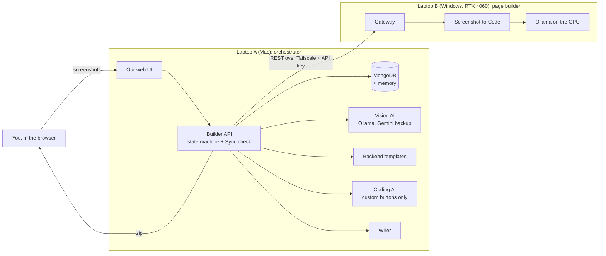

# AndarKaCode

**Screenshots in, a working app out.** You upload screenshots of an app's screens (a table of employees, a login form, a dashboard). AndarKaCode builds the pages that look like them, a backend with exactly the features those screens need, and connects the two. You download the result as a zip that runs with `npm start`.

The name is Hindi for "the code inside": the code that is hidden inside a screenshot.

> **Phase 1 (this repository): screenshot only.** The app is built from what the screenshots show and nothing else. Text requests ("also email the manager") are planned for Phase 2.

- Design: [ARCHITECTURE.md](ARCHITECTURE.md) · Progress, step by step: [plan.md](plan.md) · Test evidence for each step: [docs/tdd/](docs/tdd/)

---

## Contents

1. [What works today](#what-works-today)
2. [How it works](#how-it-works)
3. [Why it is built this way](#why-it-is-built-this-way)
4. [The app you download](#the-app-you-download)
5. [Tech stack](#tech-stack)
6. [Repository layout](#repository-layout)
7. [One-time setup](#one-time-setup)
8. [Run it](#run-it)
9. [Tests and checks](#tests-and-checks)
10. [Configuration](#configuration)
11. [Security and privacy](#security-and-privacy)
12. [Troubleshooting](#troubleshooting)
13. [What comes next](#what-comes-next)

---

## What works today

| Area | Status |
|---|---|
| Upload 1–10 screenshots (one screenshot = one page) | ✅ |
| Read each screenshot with a vision AI into a list of what is on screen ("UI inventory") | ✅ |
| Turn that list into an **App Spec** with rules (no AI), every item with its evidence ("s2: button 'Delete'") | ✅ |
| Build each page from its screenshot on the GPU laptop (Screenshot-to-Code) | ✅ |
| Generate the backend from tested templates: lists with search / filters / pages, add, edit, delete, status buttons ("Approve"), CSV export, stat cards, **login only if a login screen is shown** | ✅ |
| Sync check: pages and backend must be built from the **same** spec version | ✅ |
| **Wiring:** the page buttons really call the backend (add, edit, delete, search, filter, pages, stats, login) | ✅ |
| Our web UI: upload, live pipeline view with "how it works" for each stage, plan with evidence, page previews, generated files, **Download app (.zip)** | ✅ |
| **AI-written code for buttons no template covers** ("Give 10% Raise", "Duplicate"): checked for safety, pressed once in the real app, repaired up to 3 times, or left out on its own | ✅ Step 13 |
| **Check before download:** the app is started on a throwaway database and every page is used like a person would; the report names the part to blame (page, spec or backend); missing markers are repaired by rule | ✅ Step 16 |
| **Live preview:** use the real app in the UI before downloading, on a test database that starts with the screenshot's rows; the Pages tab opens on it once the app is Ready | ✅ Steps 16, 13 |
| **Memory:** work from Ready projects is reused: the same screenshot again is Ready in seconds; a resized or re-saved copy reuses its page; the same button on a compatible table reuses its verified code. **Start fresh** and **Clear memory** in the UI | ✅ Step 14 |
| Sandbox preview, push to GitHub | ⏳ Steps 18, 19 |

Test counts today: **Builder API 314 unit + 118 integration**, **web UI 19**, vision evaluation **41/41** on the sample screenshots, coding-model test **5/5** (Gemini) and **4/5** (local Qwen). Every step was built test-first (red → green), with a report in [docs/tdd/](docs/tdd/).

---

## How it works

Two laptops share the work. **Laptop A** (a Mac) runs the brain: our UI, the database and the Builder API. **Laptop B** (a Windows laptop with an NVIDIA RTX 4060) runs the page builder on its GPU. They talk over a private Tailscale network.



**One project, step by step** (you can watch each step as a station on the metro line in our UI):

| # | Station | Where | What happens | Time (measured) |
|---|---|---|---|---|
| 1 | **Upload** | A | Each screenshot is fingerprinted (SHA-256 for the exact file, dHash for the picture), shrunk to at most 1280 px wide and stored | instant |
| 2 | **Read** | A | A vision model lists what each screenshot shows: tables and columns, forms and inputs, buttons, search boxes, filters, page buttons, badges, stat cards, login forms. It describes *what is there*, not what to build | 10–20 s per screenshot |
| 3 | **Plan** | A | A fixed rule table turns that list into the **App Spec**: entities, fields, endpoints, buttons, stat cards, login. Every item says which screenshot element needs it. A checker rejects an incomplete spec | milliseconds |
| 4a | **Pages** | B | One job per screenshot: Screenshot-to-Code rebuilds the page with exact markers (`data-field`, `data-action`, `data-filter`, `data-stat`) taken from the spec | ~2–4 min per page locally, ~30 s with cloud |
| 4b | **Backend** | A | The template generator writes only the parts the spec lists, plus a test for each part. A button no template covers gets its code from a coding AI (see below) | milliseconds; ~5–30 s per custom button |
| 5 | **Sync check** | A | Every page and the backend carry the spec's fingerprint (hash). Only when all of them match the current version does the project become **SYNCED** | instant |
| 6 | **Wire** | A | Each page gets the binder (see below) and the wired pages are written into the app folder, which is now the finished app | instant |
| 7 | **Check** | A | The app is started on a throwaway database; in a browser without a screen, every page is used like a person would (add, reload, edit, search, filter, buttons, delete, sign in); then the app's own tests run. Each check says what happened and which part to blame: the **page**, the **spec** or the **backend** | ~5–15 s |
| 8 | **Ready** | A | Every check passed: the Pages tab opens on **Live**, the working app with the screenshot's rows, then download the zip (backend, tests, wired pages, screenshots, a README that explains why each part exists, the spec and `verify-report.md`) | instant |

With **memory** (Step 14), Read, Pages and Backend first look for the same work in an earlier Ready project. What they find is reused, and the station shows a ↻ badge, where the work came from, and the time saved (see below).

**Wiring** (Step 15) works like this. Each page gets one extra line, `<script src="app.js"></script>`, and a small "phone book", `api-map.json`, that says which marker calls which backend address. The binder (`app.js`) then:
- replaces the screenshot's sample rows with real records, as copies of the page's own sample row, so badge colours and price formats (`$2.50`) look the same;
- sends Add / Edit / Delete, search, filters, page buttons, stat cards and login to the backend;
- shows problems with the browser's own message boxes, so the page's design is untouched;
- stops the page's own "sample only" scripts from running;
- adds a marker Laptop B forgot when the page clearly shows where it belongs (a label, a column header, a button's text), and builds rows from the table header if the page drew none (Step 16).

**Buttons no template covers** (Step 13). Templates know add, edit, delete, search, filters, status buttons ("Approve"), CSV export and stat cards. Any other button, such as "Give 10% Raise" or "Duplicate", is a **custom** button, and its code comes from a coding AI:
1. **Ask.** The AI is asked for one small function in a fixed shape. It is told the button, its table's fields, and the only tools it may use: `helpers.get / list / create / update / updateMany / remove / fail`.
2. **Safety check.** The code is read as a structure, never run. Anything that could reach outside is refused with its line number: imports, `process`, `eval`, timers, network calls, endless loops, prototype tricks.
3. **Press once.** The button is pressed in the real app, on a throwaway database with two sample rows. It must answer, and a row button must leave the other row alone.
4. **Repair or isolate.** If anything fails, the AI gets the problem and tries again, up to 3 times. A button that still fails says "not available yet", and the rest of the app is built as normal.

In the downloaded app, each press runs in a separate worker thread, in a room with no access to files, settings or the network. It only reaches its own table, through the same checks as Add and Edit, and it is stopped if it hangs. The Backend station shows which AI wrote each button, or why one was left out. The Check presses each one like a person.

**Which coding AI** follows the project's mode, like the screenshot reader: **Local** uses Qwen 2.5 Coder 7B on Ollama; **Cloud** uses Gemini; **Auto** uses Gemini first, because it was right the first time on 5 of 5 test buttons against Qwen's 2 of 5, with Qwen as the backup.

**Memory** (Step 14). When a project reaches **Ready**, its verified work is kept in MongoDB under fingerprints, and later projects reuse it:

| What is kept | Reused when | What is skipped |
|---|---|---|
| What the vision AI read | the same screenshot file comes again (SHA-256) | Read, 10–20 s per screenshot |
| Each page Laptop B drew | the same screenshot with the same page instructions, **or a copy** of it (resized, re-saved: picture fingerprint at most 6 of 64 bits different) | Laptop B, 2–4 min per page |
| Each custom button's verified code | the same button on the same kind of table, **or on another table** that has every field the code uses, with the same type (the verified-code library) | the coding AI, 5–30 s per button |

- **What changes the result is part of the fingerprint,** so old memory stops matching by itself. That includes a page's instructions, the reading prompt and the button runtime.
- **Reused code is checked like new code:** the safety check and a real press in the new app.
- **A project that needs attention adds nothing** to memory.
- **Copies and different screens are far apart.** On our samples, copies of a screenshot were 2–6 bits apart, and different screens 11 or more.
- **Measured:** the same screenshot again was Ready in about 7 s instead of minutes, and a resized JPEG copy in 26 s.
- **Start fresh** (New project) skips memory for one project. **Clear memory** (sidebar) forgets everything and keeps the projects.

---

## Why it is built this way

**1. No evidence, no code.** Every backend part must point to a visible element ("s1: row button 'Delete'"), and every visible control must work. A table with only Edit/Delete gets list, update and delete. It does *not* get "create", because there is no Add button. Login code exists only if a login screen is shown. *Why:* the app does what the screenshots show, nothing is invented, and every part can be explained in a review.

**2. AI where it is needed, rules everywhere else.** AI reads the screenshots and draws the pages, because that needs vision. Turning "a table with a Delete button" into "a DELETE endpoint" is done by a fixed rule table, and the backend comes from tested templates. *Why:* the same screenshot always gives the same spec and the same code. It is fast (milliseconds), it can be tested, and it doesn't hallucinate. AI-written code is used only for buttons no template covers, and only after a safety check and a real press.

**3. One spec, fingerprinted, shared by both laptops.** The App Spec is the single source of truth. It is hashed in a fixed way (sorted keys, SHA-256, [shared/hash.mjs](shared/hash.mjs)), and every page and backend build is stamped with that hash. *Why:* if the spec is edited while a page is still building, the old page can't sneak into the app. The Sync check refuses anything built for an older version.

**4. Two laptops, each doing what it is good at.** Page building needs a GPU and takes minutes, so it runs on the RTX 4060. Everything that holds state (database, orchestrator, UI) runs on the Mac, and only the Mac starts calls. *Why:* Laptop B stays a simple, replaceable worker behind **one** door (the Gateway). If it restarts, the Mac just reports "not reachable" and carries on when it is back.

**5. Local first, cloud as backup.** By default the models run locally and for free (Ollama). Gemini is the backup, or the faster "cloud" mode. *Why:* no cost and no data leaving the laptops in normal use, with a quick fallback for demos.

**6. Wiring without changing the page's look, then checking it like a person would.** The pages Laptop B builds are kept byte for byte; one script line is added. Before anyone downloads, the app is started and used page by page. *Why:* the user gets exactly the design from the screenshot, AI-drawn pages sometimes miss a marker or even contain a script error, and it is better to catch that (and say which part to fix) than to ship a button that does nothing.

**7. Test first, for every step.** Each feature started as a failing test, then the code to pass it, with checkpoint commits and an evidence report. Real runs (real screenshots, real models, real browser) found bugs that hand-made tests did not, and each one became a new test. *Why:* a generator must be trustworthy, because a bug in it is a bug in every app it makes.

**8. Remember only what was proven, under fingerprints that change when the input changes.** Memory keeps work only from projects that passed every check, and its keys include everything that could change the result. *Why:* reusing work is only safe if it can't bring back a broken page or out-of-date code. Fingerprints instead of "looks similar" guesses keep it predictable, and no extra AI model is needed.

---

## The app you download

```
my-app/
├── README.md            how to run it, and why each part exists (with its screenshot evidence)
├── app-spec.json        the spec it was built from (version + fingerprint)
├── package.json         Express + Mongoose only
├── .env.example         MONGODB_URI, PORT (+ first-account settings only if there is a login)
├── backend/             server, models, validation, controllers, routes (+ auth/ only with a login screen,
│                        + custom/ only for buttons no template covers: their AI-written code and its runner)
├── tests/api.test.js    one test per generated part
├── frontend/            page-1.html, page-2.html, … index.html (= first page), app.js, api-map.json
└── screenshots/         the screenshots it came from
```

Run it (needs Node.js 22+ and MongoDB):

```bash
unzip my-app-v1.zip -d my-app && cd my-app
cp .env.example .env          # with a login screen: set ADMIN_EMAIL / ADMIN_PASSWORD for the first account
npm install
npm start                     # open http://localhost:3000
MONGODB_URI_TEST=mongodb://127.0.0.1:27017/app_test npm test   # its own tests (that database is emptied)
```

The pages need an internet connection for their styling (they load Tailwind CSS from its CDN).

---

## Tech stack

| Part | Technology | Why this choice |
|---|---|---|
| Runtime | **Node.js 22+** (ES modules) | One language across all services; built-in test runner, `fetch`, `--env-file` and `--watch` mean fewer packages |
| Builder API + Gateway | **Express 5** | Small, well known; Express 5 passes async errors to the error handler |
| Database | **MongoDB** + **Mongoose 9** | Specs, jobs and generated apps are document-shaped; the generated apps use the same stack |
| Uploads / images | **multer 2**, **sharp** | In-memory upload with type and size limits; fast resizing before the vision pass |
| Vision AI (read screenshots) | **Ollama** with `qwen3-vl:8b-instruct`; backup **Gemini** (`gemini-3-flash-preview`) | Runs locally for free; cloud backup when local is slow or down |
| Coding AI (custom buttons) | **Ollama** with `qwen2.5-coder:7b`; **Gemini** (`gemini-3.5-flash` in our test) | Chosen by a test of 5 buttons with known right answers (see [docs/tdd/step13-custom.tdd.md](docs/tdd/step13-custom.tdd.md)) |
| Code safety check | **acorn** (a JavaScript parser) | Reads AI code and page sample data as a structure, without running it |
| Page builder | **[Screenshot-to-Code](https://github.com/abi/screenshot-to-code)** (commit `a813977` + [our patch](docs/s2c-local.patch)), on **Ollama with CUDA** (RTX 4060) | Proven screenshot → HTML tool; our patch adds Windows fixes, one variant, retries and a step limit |
| Network between laptops | **Tailscale** + API key header | Private network; the Gateway is never on the open Wi-Fi |
| Generated backend | **Express 5 + Mongoose 9**, Node's built-in test runner | Only two dependencies, easy to read and run |
| Generated pages | HTML + **Tailwind CSS** (from Screenshot-to-Code) + our **binder** (plain JavaScript, no packages) | The page keeps the screenshot's look; the binder works in any page |
| Our web UI | **React 19** + **Vite 8**, fonts via **@fontsource** (Baloo 2, Atkinson Hyperlegible, JetBrains Mono) | Fast build; fonts bundled, so no outside font requests; served by the Builder API at the same address |
| Download | Our own zip writer (Node `zlib`) | No extra package; checked with the operating system's `tar` |
| Tests | `node:test`, **jsdom 29** (development only, a browser without a screen), real headless Chrome for the smoke check | Fast tests on both laptops; jsdom runs page scripts in the same order as a browser |

---

## Repository layout

| Folder | Runs on | What it is |
|---|---|---|
| [`builder-api/`](builder-api/) | Laptop A | Orchestrator: upload, vision reading, spec deriver, pipeline state machine, Sync check, backend generator, custom-button AI, Wirer, Verifier, live preview, memory, zip download; serves the UI |
| [`web/`](web/) | Laptop A | Our React UI (built into `web/dist`, served by the Builder API) |
| [`templates/`](templates/) | Laptop A | Backend templates (`templates/backend/`) and the page binder (`templates/frontend/app.js`) |
| [`shared/`](shared/) | Both | Spec / inventory JSON schemas and the spec fingerprint (hash) |
| [`gateway/`](gateway/) | Laptop B | REST front door to Screenshot-to-Code: API key, one job at a time, local / cloud / auto mode, cache |
| [`scripts/`](scripts/) | Laptop B | `start-laptop-b.ps1`: starts Ollama, Screenshot-to-Code and the Gateway |
| [`samples/`](samples/) | Either | Test screenshots (`samples/mocks/m1…m8`; m7 has custom buttons, m8 the same raise button on another table) and example outputs |
| [`spikes/`](spikes/) | Either | Early experiments from Phase 1 (kept for reference) |
| [`docs/`](docs/) | – | Screenshot-to-Code patch, TDD evidence reports |
| [`instructions/`](instructions/) | – | The instruction text used in the early page-building experiments |

---

## One-time setup

**Both laptops**
- Node.js 22 or newer, and Git.
- Tailscale installed and signed in to the same network.

**Laptop A (Mac)**
```bash
brew install mongodb-community && brew services start mongodb-community
# Ollama app installed, then:
ollama pull qwen3-vl:8b-instruct
ollama pull qwen2.5-coder:7b        # the coding AI for custom buttons (about 4.7 GB)

cd builder-api && npm install && cp .env.example .env    # fill in GATEWAY_URL and GATEWAY_API_KEY (see Configuration)
cd ../web && npm install && npm run build                 # repeat the build after every change in web/
```

**Laptop B (Windows, NVIDIA GPU)**
1. Install Ollama, pull `qwen3-vl:8b-instruct`, and create the local model name Screenshot-to-Code asks for (`gpt-5.5`) from it. The settings used (context size, GPU options) are in [ARCHITECTURE.md §5](ARCHITECTURE.md).
2. Install Screenshot-to-Code at commit `a813977`, apply [docs/s2c-local.patch](docs/s2c-local.patch), and install its backend (Poetry). It must not hold any API keys; the Gateway passes them per request.
3. Set up the Gateway:
   ```powershell
   cd gateway; npm install; copy .env.example .env
   # HOST = this laptop's Tailscale address (tailscale ip -4), GATEWAY_API_KEY = a long random secret
   ```

---

## Run it

**1. Laptop B**: open the Tailscale app (Connected), then from the repository folder:
```powershell
powershell -ExecutionPolicy Bypass -File scripts\start-laptop-b.ps1
# optional: -S2cBackend <path to screenshot-to-code\backend> if it is not in the default place
```
It starts Ollama (port 11434), Screenshot-to-Code (port 7001) and the Gateway (port 8787), each in its own window. Leave them open. Running it twice is safe.

**2. Laptop A**: Tailscale connected, Ollama running, then:
```bash
brew services start mongodb-community      # once after a reboot
cd builder-api && npm start                # → Builder API listening on http://127.0.0.1:4000
curl -s http://127.0.0.1:4000/api/health   # optional: "db":true and "reachable":true
```

**3. Open http://127.0.0.1:4000** on Laptop A. The two lights in the top right (Mac, Windows GPU) should be green.
- **New project** → drop screenshots → set their order → name → AI mode (**Local**: free, on your GPUs; **Cloud**: Gemini, faster, limited free requests; **Auto**: screenshots are read locally first, custom-button code is written by Gemini first, each with the other as backup) → start.
- Watch the stations; click one to read how it works. A ↻ badge means that station reused earlier work from memory; tick **Start fresh** on New project to build everything again.
- **After every `git pull`:** restart the Builder API, and run `cd web && npm run build` if the UI changed. Until then the old code keeps running.
- After the Sync check come **Wire** and **Check**. At **Ready**, the Pages tab opens on **Live**: the working app on a test database, already holding the screenshot's rows, so every button can be tried (As built is only Laptop B's drawing). Then click **Download app (.zip)**. If a check fails, the Check station says which control failed, what the backend answered, and which part to blame; **Download anyway** gives you the zip with its report.

**While changing the UI:** `cd web && npm run dev` serves it at http://127.0.0.1:5173 with live reload (the Builder API must be running).

**Stopping:** press `Ctrl+C` in the Builder API terminal; on Laptop B close the Gateway and Screenshot-to-Code windows. MongoDB can keep running (`brew services stop mongodb-community` stops it).

---

## Tests and checks

```bash
# Builder API (Laptop A or B)
cd builder-api
npm test                         # unit tests (314): spec rules, generator, wirer, binder in jsdom, verifier, code safety, memory, …
npm run test:coverage            # the same, with a coverage table
TEST_MONGODB_URI=mongodb://127.0.0.1:27017/builder_test \
  node --test --test-concurrency=1 --test-reporter=tap "integration/**/*.test.js" | grep -E "^# (pass|fail)"
                                 # integration tests (118): whole pipeline (Wire, Check, Ready) with a fake Gateway,
                                 # generated apps on a real MongoDB, custom-button code, the Verifier, the live preview,
                                 # memory (repeats make no AI or Gateway call).
                                 # Databases are dropped.
npm run eval:inventory           # reads the sample screenshots with the real vision model (needs Ollama)
TEST_MONGODB_URI=mongodb://127.0.0.1:27017/modeltest npm run eval:custom -- --provider local
                                 # coding-model test: 5 buttons with known right answers (--provider cloud for Gemini)

# A downloaded app, in real headless Chrome (the app must be running with npm start)
npm run smoke:wire -- http://localhost:3000
npm run smoke:wire -- http://localhost:3000 --email admin@example.com --password <its ADMIN_PASSWORD>   # apps with a login

# Our web UI
cd ../web && npm test            # pipeline view logic (19)
```

On Windows PowerShell, set the database for the integration tests with `$env:TEST_MONGODB_URI = "mongodb://127.0.0.1:27017/builder_test"` and run the same `node --test …` line.

---

## Configuration

Each service reads its own `.env` (copy it from `.env.example`). `.env` files are git-ignored and never committed. Only the variable **names** are listed here.

**`builder-api/.env` (Laptop A)**

| Variable | Meaning |
|---|---|
| `PORT`, `HOST` | Where the Builder API and UI listen (default `127.0.0.1:4000`: this computer only) |
| `PREVIEW_PORT` | The live preview's own local port (default: `PORT` + 1, e.g. 4001) |
| `PREVIEW_IDLE_MS` | How long a live preview runs without use before it stops (default 15 minutes) |
| `MONGODB_URI` | Our own database (default `mongodb://127.0.0.1:27017/builder_db`) |
| `DEFAULT_MODE` | `local`, `cloud` or `auto` for new projects |
| `GATEWAY_URL` | Laptop B's Gateway on its Tailscale address, e.g. `http://100.x.y.z:8787` |
| `GATEWAY_API_KEY` | Shared secret; must equal the Gateway's |
| `OLLAMA_URL`, `OLLAMA_MODEL` | Local vision model (default `qwen3-vl:8b-instruct`) |
| `GEMINI_API_KEY`, `GEMINI_MODEL` | Optional cloud backup for reading screenshots |
| `OLLAMA_CODE_MODEL` | Local coding AI for custom buttons (default `qwen2.5-coder:7b`) |
| `GEMINI_CODE_MODEL` | Cloud coding AI (default: `GEMINI_MODEL`; `gemini-3.5-flash` scored 5/5 in our test) |

**`gateway/.env` (Laptop B)**

| Variable | Meaning |
|---|---|
| `PORT`, `HOST` | `8787` on the Tailscale address only (use `127.0.0.1` to test on Laptop B alone) |
| `GATEWAY_API_KEY` | Shared secret the Builder API sends in the `X-API-Key` header |
| `S2C_WS_URL`, `OLLAMA_URL` | Screenshot-to-Code and Ollama on this laptop (localhost) |
| `GEMINI_API_KEY` | Optional; enables cloud mode for page building |

**Generated app's `.env`**: `MONGODB_URI`, `PORT`, and only when a login screen was shown: `ADMIN_EMAIL`, `ADMIN_PASSWORD` (the first account), `SESSION_HOURS`.

---

## Security and privacy

- **Secrets stay out of Git.** Only `.env.example` files are committed. Screenshot-to-Code holds no keys; the Gateway passes them per request.
- **Small attack surface.** The Builder API listens on `127.0.0.1` only (there is no user login yet). The Gateway is the only service Laptop B exposes, only on the private Tailscale address, and only with the API key. Ollama and Screenshot-to-Code stay on localhost.
- **Uploads are checked.** Only PNG / JPEG / WebP, at most 10 MB each, and decoded before anything is stored. Generated-file viewing refuses paths outside the app folder.
- **Generated apps:**
  - Login exists only if a login screen was shown. Passwords are hashed with scrypt; only a SHA-256 fingerprint of each login token is stored; sign-in for an email pauses for a minute after 5 wrong passwords.
  - CSV export guards against spreadsheet formulas.
  - The binder inserts data as text, never as HTML.
  - AI-written button code passes a safety check before it is ever run. In the app, each press runs in its own worker thread with no files, settings, network or code-from-strings; it reaches only its own table through the normal checks, and it is stopped after 2 s without progress (30 s in all).
  - The live preview's starting rows are read from the page as data; the page's code is not run to get them.
- **Checking and previews run the generated app safely:** in its own process, on `127.0.0.1` only, with its own throwaway database and no keys in its environment. It stops with the Builder API. The live preview has its own local port, so the browser treats it as another site than our UI, and a generated page can't reach the UI.
- **Local first.** In Local mode, screenshots and code never leave the two laptops.
- **Memory stays on the Mac,** in its own MongoDB. Only work from projects that passed every check is kept, and **Clear memory** removes it all.

---

## Troubleshooting

| What you see | What to do |
|---|---|
| **Windows GPU** light red, or "Gateway … not reachable" | On Laptop B: Tailscale connected? Run the start script again |
| `Cannot connect to MongoDB` | `brew services start mongodb-community` |
| `EADDRINUSE` on port 4000 | An old Builder API is still running: close it (`lsof -i :4000`, then stop that process) |
| `Cannot GET /` on port 4000 | Build the UI: `cd web && npm run build`, then restart the Builder API |
| The Read station fails | Ollama on Laptop A is not running, or the model is missing (`ollama list`) |
| Pages look unstyled | Connect to the internet (Tailwind CDN) |
| A downloaded page shows an alert about `npm start` | Open it through `npm start` and `http://localhost:3000`, not as a file |
| "The live preview could not start" / port 4001 in use | Set `PREVIEW_PORT` to a free port in `builder-api/.env` and restart the Builder API |
| A custom button says "not available yet" | Its code never passed. The Backend station shows the last problem. Try Cloud or Auto mode (Gemini was right more often), or check that `ollama list` shows `qwen2.5-coder:7b` |
| After `git pull`, nothing new happens | Restart the Builder API (and `cd web && npm run build` for UI changes) |
| A repeat upload is not reused from memory | Memory only holds projects that reached **Ready** after Step 14, and **Start fresh** skips it. A copy counts only if it's at most 6 bits from the original and its page instructions are the same |
| The Check station failed | Read its report: each failed check names the control, the backend's answer and the part to fix (page, spec or backend) |

---

## What comes next

The order is in [plan.md](plan.md):
- **Steps 17–20:** editing the spec in the UI, sandbox preview, publishing to GitHub, demo rehearsal.
- **Phase 2:** text requests and chat-style changes on top of the same spec, evidence and checks.
