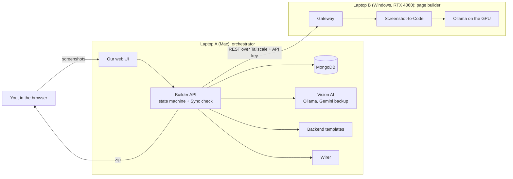

# AndarKaCode

<<<<<<< HEAD
**Screenshots in, a working app out.** You upload screenshots of an app's screens (a table of employees, a login form, a dashboard). AndarKaCode builds the pages that look like them, a backend with exactly the features those screens need, and connects the two. You download the result as a zip that runs with `npm start`.

The name is Hindi for "the code inside": the code that is hidden inside a screenshot.

> **Phase 1 (this repository): screenshot only.** The app is built from what the screenshots show and nothing else. Text requests ("also email the manager") are planned for Phase 2.

- Design: [ARCHITECTURE.md](ARCHITECTURE.md) · Progress, step by step: [plan.md](plan.md) · Test evidence for each step: [docs/tdd/](docs/tdd/)

---

## Contents

1. [What works today](#what-works-today)
2. [How it works](#how-it-works)
3. [Why it is built this way](#why-it-is-built-this-way)
4. [The app you download](#the-app-you-download)
5. [Tech stack](#tech-stack)
6. [Repository layout](#repository-layout)
7. [One-time setup](#one-time-setup)
8. [Run it](#run-it)
9. [Tests and checks](#tests-and-checks)
10. [Configuration](#configuration)
11. [Security and privacy](#security-and-privacy)
12. [Troubleshooting](#troubleshooting)
13. [What comes next](#what-comes-next)

---

## What works today

| Area | Status |
|---|---|
| Upload 1–10 screenshots (one screenshot = one page) | ✅ |
| Read each screenshot with a vision AI into a list of what is on screen ("UI inventory") | ✅ |
| Turn that list into an **App Spec** with rules (no AI), every item with its evidence ("s2: button 'Delete'") | ✅ |
| Build each page from its screenshot on the GPU laptop (Screenshot-to-Code) | ✅ |
| Generate the backend from tested templates: lists with search / filters / pages, add, edit, delete, status buttons ("Approve"), CSV export, stat cards, **login only if a login screen is shown** | ✅ |
| Sync check: pages and backend must be built from the **same** spec version | ✅ |
| **Wiring:** the page buttons really call the backend (add, edit, delete, search, filter, pages, stats, login) | ✅ |
| Our web UI: upload, live pipeline view with "how it works" for each stage, plan with evidence, page previews, generated files, **Download app (.zip)** | ✅ |
| AI-written code for buttons no template covers (they answer "not available yet" for now) | ⏳ Step 13 |
| Automatic verifier + repair before download | ⏳ Step 16 |
| Memory (instant repeats, similar screenshots), sandbox preview, push to GitHub | ⏳ Steps 14, 18, 19 |

Test counts today: **Builder API 195 unit + 47 integration**, **web UI 8**, vision evaluation **41/41** on the sample screenshots. Every step was built test-first (red → green), with a report in [docs/tdd/](docs/tdd/).

---

## How it works

Two laptops share the work. **Laptop A** (a Mac) runs the brain: our UI, the database and the Builder API. **Laptop B** (a Windows laptop with an NVIDIA RTX 4060) runs the page builder on its GPU. They talk over a private Tailscale network.



**One project, step by step** (you can watch each step as a station on the metro line in our UI):

| # | Station | Where | What happens | Time (measured) |
|---|---|---|---|---|
| 1 | **Upload** | A | Each screenshot is fingerprinted (SHA-256), shrunk to at most 1280 px wide and stored | instant |
| 2 | **Read** | A | A vision model lists what each screenshot shows: tables and columns, forms and inputs, buttons, search boxes, filters, page buttons, badges, stat cards, login forms. It describes *what is there*, not what to build | 10–20 s per screenshot |
| 3 | **Plan** | A | A fixed rule table turns that list into the **App Spec**: entities, fields, endpoints, buttons, stat cards, login. Every item says which screenshot element needs it. A checker rejects an incomplete spec | milliseconds |
| 4a | **Pages** | B | One job per screenshot: Screenshot-to-Code rebuilds the page with exact markers (`data-field`, `data-action`, `data-filter`, `data-stat`) taken from the spec | ~2–4 min per page locally, ~30 s with cloud |
| 4b | **Backend** | A | The template generator writes only the parts the spec lists, plus a test for each part | milliseconds |
| 5 | **Sync check** | A | Every page and the backend carry the spec's fingerprint (hash). Only when all of them match the current version does the project become **SYNCED** | instant |
| 6 | **Download** | A | The zip is assembled: backend, tests, the pages **wired** to the backend, screenshots, a README that explains why each part exists, and the spec | instant |

**Wiring** (Step 15) works like this. Each downloaded page gets one extra line, `<script src="app.js"></script>`, and a small "phone book", `api-map.json`, that says which marker calls which backend address. The binder (`app.js`) then:
- replaces the screenshot's sample rows with real records, as copies of the page's own sample row, so badge colours and price formats (`$2.50`) look the same;
- sends Add / Edit / Delete, search, filters, page buttons, stat cards and login to the backend;
- shows problems with the browser's own message boxes, so the page's design is untouched;
- stops the page's own "sample only" scripts from running.

---

## Why it is built this way

**1. No evidence, no code.** Every backend part must point to a visible element ("s1: row button 'Delete'"), and every visible control must work. A table with only Edit/Delete gets list, update and delete. It does *not* get "create", because there is no Add button. Login code exists only if a login screen is shown. *Why:* the app does what the screenshots show, nothing is invented, and every part can be explained in a review.

**2. AI where it is needed, rules everywhere else.** AI reads the screenshots and draws the pages, because that needs vision. Turning "a table with a Delete button" into "a DELETE endpoint" is done by a fixed rule table, and the backend comes from tested templates. *Why:* the same screenshot always gives the same spec and the same code. It is fast (milliseconds), it can be tested, and it doesn't hallucinate. AI-written code will be used only for buttons no template covers (Step 13), and only if its tests pass.

**3. One spec, fingerprinted, shared by both laptops.** The App Spec is the single source of truth. It is hashed in a fixed way (sorted keys, SHA-256, [shared/hash.mjs](shared/hash.mjs)), and every page and backend build is stamped with that hash. *Why:* if the spec is edited while a page is still building, the old page can't sneak into the app. The Sync check refuses anything built for an older version.

**4. Two laptops, each doing what it is good at.** Page building needs a GPU and takes minutes, so it runs on the RTX 4060. Everything that holds state (database, orchestrator, UI) runs on the Mac, and only the Mac starts calls. *Why:* Laptop B stays a simple, replaceable worker behind **one** door (the Gateway). If it restarts, the Mac just reports "not reachable" and carries on when it is back.

**5. Local first, cloud as backup.** By default the models run locally and for free (Ollama). Gemini is the backup, or the faster "cloud" mode. *Why:* no cost and no data leaving the laptops in normal use, with a quick fallback for demos.

**6. Wiring at download time, without changing the page's look.** The pages Laptop B builds are kept byte for byte; one script line is added. *Why:* the user gets exactly the design from the screenshot, and our UI's page previews stay as built. The wiring is plain code, so it takes milliseconds.

**7. Test first, for every step.** Each feature started as a failing test, then the code to pass it, with checkpoint commits and an evidence report. Real runs (real screenshots, real models, real browser) found bugs that hand-made tests did not, and each one became a new test. *Why:* a generator must be trustworthy, because a bug in it is a bug in every app it makes.

---

## The app you download

```
my-app/
├── README.md            how to run it, and why each part exists (with its screenshot evidence)
├── app-spec.json        the spec it was built from (version + fingerprint)
├── package.json         Express + Mongoose only
├── .env.example         MONGODB_URI, PORT (+ first-account settings only if there is a login)
├── backend/             server, models, validation, controllers, routes (+ auth/ only with a login screen)
├── tests/api.test.js    one test per generated part
├── frontend/            page-1.html, page-2.html, … index.html (= first page), app.js, api-map.json
└── screenshots/         the screenshots it came from
```

Run it (needs Node.js 22+ and MongoDB):

```bash
unzip my-app-v1.zip -d my-app && cd my-app
cp .env.example .env          # with a login screen: set ADMIN_EMAIL / ADMIN_PASSWORD for the first account
npm install
npm start                     # open http://localhost:3000
MONGODB_URI_TEST=mongodb://127.0.0.1:27017/app_test npm test   # its own tests (that database is emptied)
```

The pages need an internet connection for their styling (they load Tailwind CSS from its CDN).

---

## Tech stack

| Part | Technology | Why this choice |
|---|---|---|
| Runtime | **Node.js 22+** (ES modules) | One language across all services; built-in test runner, `fetch`, `--env-file` and `--watch` mean fewer packages |
| Builder API + Gateway | **Express 5** | Small, well known; Express 5 passes async errors to the error handler |
| Database | **MongoDB** + **Mongoose 9** | Specs, jobs and generated apps are document-shaped; the generated apps use the same stack |
| Uploads / images | **multer 2**, **sharp** | In-memory upload with type and size limits; fast resizing before the vision pass |
| Vision AI (read screenshots) | **Ollama** with `qwen3-vl:8b-instruct`; backup **Gemini** (`gemini-3-flash-preview`) | Runs locally for free; cloud backup when local is slow or down |
| Page builder | **[Screenshot-to-Code](https://github.com/abi/screenshot-to-code)** (commit `a813977` + [our patch](docs/s2c-local.patch)), on **Ollama with CUDA** (RTX 4060) | Proven screenshot → HTML tool; our patch adds Windows fixes, one variant, retries and a step limit |
| Network between laptops | **Tailscale** + API key header | Private network; the Gateway is never on the open Wi-Fi |
| Generated backend | **Express 5 + Mongoose 9**, Node's built-in test runner | Only two dependencies, easy to read and run |
| Generated pages | HTML + **Tailwind CSS** (from Screenshot-to-Code) + our **binder** (plain JavaScript, no packages) | The page keeps the screenshot's look; the binder works in any page |
| Our web UI | **React 19** + **Vite 8**, fonts via **@fontsource** (Baloo 2, Atkinson Hyperlegible, JetBrains Mono) | Fast build; fonts bundled, so no outside font requests; served by the Builder API at the same address |
| Download | Our own zip writer (Node `zlib`) | No extra package; checked with the operating system's `tar` |
| Tests | `node:test`, **jsdom 29** (development only, a browser without a screen), real headless Chrome for the smoke check | Fast tests on both laptops; jsdom runs page scripts in the same order as a browser |

---

## Repository layout

| Folder | Runs on | What it is |
|---|---|---|
| [`builder-api/`](builder-api/) | Laptop A | Orchestrator: upload, vision reading, spec deriver, pipeline state machine, Sync check, backend generator, Wirer, zip download; serves the UI |
| [`web/`](web/) | Laptop A | Our React UI (built into `web/dist`, served by the Builder API) |
| [`templates/`](templates/) | Laptop A | Backend templates (`templates/backend/`) and the page binder (`templates/frontend/app.js`) |
| [`shared/`](shared/) | Both | Spec / inventory JSON schemas and the spec fingerprint (hash) |
| [`gateway/`](gateway/) | Laptop B | REST front door to Screenshot-to-Code: API key, one job at a time, local / cloud / auto mode, cache |
| [`scripts/`](scripts/) | Laptop B | `start-laptop-b.ps1`: starts Ollama, Screenshot-to-Code and the Gateway |
| [`samples/`](samples/) | Either | Test screenshots (`samples/mocks/m1…m6`) and example outputs |
| [`spikes/`](spikes/) | Either | Early experiments from Phase 1 (kept for reference) |
| [`docs/`](docs/) | – | Screenshot-to-Code patch, TDD evidence reports |
| [`instructions/`](instructions/) | – | The instruction text used in the early page-building experiments |

---

## One-time setup

**Both laptops**
- Node.js 22 or newer, and Git.
- Tailscale installed and signed in to the same network.

**Laptop A (Mac)**
```bash
brew install mongodb-community && brew services start mongodb-community
# Ollama app installed, then:
ollama pull qwen3-vl:8b-instruct

cd builder-api && npm install && cp .env.example .env    # fill in GATEWAY_URL and GATEWAY_API_KEY (see Configuration)
cd ../web && npm install && npm run build                 # repeat the build after every change in web/
```

**Laptop B (Windows, NVIDIA GPU)**
1. Install Ollama, pull `qwen3-vl:8b-instruct`, and create the local model name Screenshot-to-Code asks for (`gpt-5.5`) from it. The settings used (context size, GPU options) are in [ARCHITECTURE.md §5](ARCHITECTURE.md).
2. Install Screenshot-to-Code at commit `a813977`, apply [docs/s2c-local.patch](docs/s2c-local.patch), and install its backend (Poetry). It must not hold any API keys; the Gateway passes them per request.
3. Set up the Gateway:
   ```powershell
   cd gateway; npm install; copy .env.example .env
   # HOST = this laptop's Tailscale address (tailscale ip -4), GATEWAY_API_KEY = a long random secret
   ```

---

## Run it

**1. Laptop B**: open the Tailscale app (Connected), then from the repository folder:
```powershell
powershell -ExecutionPolicy Bypass -File scripts\start-laptop-b.ps1
# optional: -S2cBackend <path to screenshot-to-code\backend> if it is not in the default place
```
It starts Ollama (port 11434), Screenshot-to-Code (port 7001) and the Gateway (port 8787), each in its own window. Leave them open. Running it twice is safe.

**2. Laptop A**: Tailscale connected, Ollama running, then:
```bash
brew services start mongodb-community      # once after a reboot
cd builder-api && npm start                # → Builder API listening on http://127.0.0.1:4000
curl -s http://127.0.0.1:4000/api/health   # optional: "db":true and "reachable":true
```

**3. Open http://127.0.0.1:4000** on Laptop A. The two lights in the top right (Mac, Windows GPU) should be green.
- **New project** → drop screenshots → set their order → name → AI mode (**Local**: free, on your GPUs; **Cloud**: Gemini, faster, limited free requests; **Auto**: local, then cloud) → start.
- Watch the stations; click one to read how it works.
- When the Sync check is done, click **Download app (.zip)**.

**While changing the UI:** `cd web && npm run dev` serves it at http://127.0.0.1:5173 with live reload (the Builder API must be running).

**Stopping:** press `Ctrl+C` in the Builder API terminal; on Laptop B close the Gateway and Screenshot-to-Code windows. MongoDB can keep running (`brew services stop mongodb-community` stops it).

---

## Tests and checks

```bash
# Builder API (Laptop A or B)
cd builder-api
npm test                         # unit tests (195): spec rules, generator, wirer, binder in jsdom, zip, …
npm run test:coverage            # the same, with a coverage table
TEST_MONGODB_URI=mongodb://127.0.0.1:27017/builder_test \
  node --test --test-concurrency=1 --test-reporter=tap "integration/**/*.test.js" | grep -E "^# (pass|fail)"
                                 # integration tests (47): whole pipeline with a fake Gateway, generated
                                 # backends on a real MongoDB, wired pages end to end. The database is dropped.
npm run eval:inventory           # reads the sample screenshots with the real vision model (needs Ollama)

# A downloaded app, in real headless Chrome (the app must be running with npm start)
npm run smoke:wire -- http://localhost:3000
npm run smoke:wire -- http://localhost:3000 --email admin@example.com --password <its ADMIN_PASSWORD>   # apps with a login

# Our web UI
cd ../web && npm test            # pipeline view logic (8)
```

On Windows PowerShell, set the database for the integration tests with `$env:TEST_MONGODB_URI = "mongodb://127.0.0.1:27017/builder_test"` and run the same `node --test …` line.

---

## Configuration

Each service reads its own `.env` (copy it from `.env.example`). `.env` files are git-ignored and never committed. Only the variable **names** are listed here.

**`builder-api/.env` (Laptop A)**

| Variable | Meaning |
|---|---|
| `PORT`, `HOST` | Where the Builder API and UI listen (default `127.0.0.1:4000`: this computer only) |
| `MONGODB_URI` | Our own database (default `mongodb://127.0.0.1:27017/builder_db`) |
| `DEFAULT_MODE` | `local`, `cloud` or `auto` for new projects |
| `GATEWAY_URL` | Laptop B's Gateway on its Tailscale address, e.g. `http://100.x.y.z:8787` |
| `GATEWAY_API_KEY` | Shared secret; must equal the Gateway's |
| `OLLAMA_URL`, `OLLAMA_MODEL` | Local vision model (default `qwen3-vl:8b-instruct`) |
| `GEMINI_API_KEY`, `GEMINI_MODEL` | Optional cloud backup for reading screenshots |

**`gateway/.env` (Laptop B)**

| Variable | Meaning |
|---|---|
| `PORT`, `HOST` | `8787` on the Tailscale address only (use `127.0.0.1` to test on Laptop B alone) |
| `GATEWAY_API_KEY` | Shared secret the Builder API sends in the `X-API-Key` header |
| `S2C_WS_URL`, `OLLAMA_URL` | Screenshot-to-Code and Ollama on this laptop (localhost) |
| `GEMINI_API_KEY` | Optional; enables cloud mode for page building |

**Generated app's `.env`**: `MONGODB_URI`, `PORT`, and only when a login screen was shown: `ADMIN_EMAIL`, `ADMIN_PASSWORD` (the first account), `SESSION_HOURS`.

---

## Security and privacy

- **Secrets stay out of Git.** Only `.env.example` files are committed. Screenshot-to-Code holds no keys; the Gateway passes them per request.
- **Small attack surface.** The Builder API listens on `127.0.0.1` only (there is no user login yet). The Gateway is the only service Laptop B exposes, only on the private Tailscale address, and only with the API key. Ollama and Screenshot-to-Code stay on localhost.
- **Uploads are checked.** Only PNG / JPEG / WebP, at most 10 MB each, and decoded before anything is stored. Generated-file viewing refuses paths outside the app folder.
- **Generated apps:**
  - Login exists only if a login screen was shown. Passwords are hashed with scrypt; only a SHA-256 fingerprint of each login token is stored; sign-in for an email pauses for a minute after 5 wrong passwords.
  - CSV export guards against spreadsheet formulas.
  - The binder inserts data as text, never as HTML.
- **Local first.** In Local mode, screenshots and code never leave the two laptops.

---

## Troubleshooting

| What you see | What to do |
|---|---|
| **Windows GPU** light red, or "Gateway … not reachable" | On Laptop B: Tailscale connected? Run the start script again |
| `Cannot connect to MongoDB` | `brew services start mongodb-community` |
| `EADDRINUSE` on port 4000 | An old Builder API is still running: close it (`lsof -i :4000`, then stop that process) |
| `Cannot GET /` on port 4000 | Build the UI: `cd web && npm run build`, then restart the Builder API |
| The Read station fails | Ollama on Laptop A is not running, or the model is missing (`ollama list`) |
| Pages look unstyled | Connect to the internet (Tailwind CDN) |
| A downloaded page shows an alert about `npm start` | Open it through `npm start` and `http://localhost:3000`, not as a file |

---

## What comes next

The order is in [plan.md](plan.md):
- **Step 16:** an automatic verifier (every marker present, every control backed, nothing unnecessary, the app's own tests pass) with repair before download.
- **Step 13:** AI code for buttons no template covers, checked for safety, tested in a sandbox, repaired or isolated.
- **Step 14:** memory, so repeats are instant and similar screenshots reuse earlier work.
- **Steps 17–20:** editing the spec in the UI, sandbox preview, publishing to GitHub, demo rehearsal.
- **Phase 2:** text requests and chat-style changes on top of the same spec, evidence and checks.
=======
> **Screenshot in, working full-stack app out.**  
> Deterministic frontend and backend generation backed strictly by visible UI evidence.

[](#testing)
[-blue)](#roadmap)
[](#prerequisites)

---

## 🎯 The Guiding Rule: "No Evidence, No Code"

Traditional LLM code generators hallucinate unrequested schemas and broken endpoints. **AndarKaCode** derives code deterministically:

- **100% Traceable:** Every database model, Express route, and input validation rule points directly to a visible element on an uploaded screenshot.
- **Zero Ghost Code:** If no "Add" button is visible, no `POST /create` is generated. If no login screen is uploaded, **zero authentication code** is created.
- **Deterministic Contract:** Frontend and backend generation run against a shared SHA-256 Contract hash verified by the **Sync Barrier**.

---

## 🔄 How It Works (Pipeline Flow)

```
[UI Screenshots]
       │
       ▼
 1. Upload & Scale ───► SHA-256 fingerprint; image scaled to ≤ 1280px
       │
       ▼
 2. Vision Inventory ─► Ollama (Qwen3-VL) catalogs tables, buttons, inputs & cards
       │
       ▼
 3. Spec Deriver ─────► Deterministic rules compile App Spec with visible evidence
       │
       ▼
 4. Dual Generation ──► ┌─► Laptop B (GPU): S2C redraws HTML + markers (~2.5 min)
                        └─► Laptop A (Templates): Express CRUD + tests (<100 ms)
       │
       ▼
 5. Sync Barrier ─────► Verifies frontend & backend share identical Contract Hash
       │
       ▼
 6. Runtime Wirer ────► Injects `app.js` binder (preserves CSS, in-row edits, auth)
       │
       ▼
[Ready-to-Run App ZIP] (Express + MongoDB + Tailwind HTML)
```

---

## 🏗️ Architecture & Topology

The system splits heavy GPU vision tasks from orchestration across two machines:

| Service | Folder | Runs On | Port | Role |
|---|---|---|---|---|
| **Gateway** | [`gateway/`](gateway/) | Laptop B (Windows GPU) | `8787` | REST front-door with FIFO queue wrapping Ollama & S2C |
| **Builder API** | [`builder-api/`](builder-api/) | Laptop A (Mac / Host) | `4000` | State machine orchestrator, MongoDB, Spec Deriver, Templates |
| **Web UI** | [`web/`](web/) | Laptop A (Mac / Host) | `5173` | React / Vite dashboard with live Metro-Line pipeline tracker |
| **Templates** | [`templates/`](templates/) | Laptop A | — | Deterministic backend templates and frontend runtime binder (`app.js`) |
| **Shared** | [`shared/`](shared/) | Both | — | Shared contract schemas and hash verification logic |

> **Network Link:** Services communicate over a secure Tailscale overlay network protected by `X-API-Key` authentication.

---

## 🚀 Quick Start

### Prerequisites
- **Node.js** `>= 22.0.0`
- **MongoDB** running locally on port `27017`
- *(Laptop B only)*: NVIDIA GPU with **Ollama** (`qwen3-vl:8b`) and **Screenshot-to-Code**

### 1. Install Dependencies
```bash
# In the repository root
cd builder-api && npm install && cd ..
cd gateway && npm install && cd ..
cd web && npm install && cd ..
cd templates && npm install && cd ..
```

### 2. Configure Environment Files
Copy the `.env.example` templates:
```bash
cp builder-api/.env.example builder-api/.env
cp gateway/.env.example gateway/.env
```
*(If running both locally on one machine for development, set `HOST=127.0.0.1` and `GATEWAY_URL=http://127.0.0.1:8787`).*

### 3. Start Laptop B (GPU Worker)
On Windows, run the automated launch script:
```powershell
powershell -ExecutionPolicy Bypass -File scripts\start-laptop-b.ps1
```
*This starts Ollama, Screenshot-to-Code (`:7001`), and the Gateway (`:8787`).*

### 4. Start Laptop A (Orchestrator & UI)
```bash
# Terminal 1: Start Builder API
cd builder-api
npm start

# Terminal 2: Start React Web UI
cd web
npm run dev
```
Open **http://127.0.0.1:5173** to drop screenshots and track the live pipeline.

---

## 🧪 Testing & Verification

Comprehensive test suites ensure zero regressions across both units and end-to-end browser execution:

```bash
cd builder-api

# Run all 195 unit tests
npm test

# Run integration tests against real MongoDB
npm run test:integration

# Run real headless Google Chrome smoke tests (Wirer & Binder verification)
npm run smoke:wire
```

---

## 🗺️ Project Roadmap & Status

| Step | Milestone | Status | Description |
|---|---|---|---|
| **1–4** | GPU & Vision Spikes | ✅ Done | Ollama on GPU, S2C patching, prompt instructions, contract extraction. |
| **5–7** | Connectivity & Gateway | ✅ Done | Monorepo layout, REST Gateway queue, Tailscale cross-machine calls. |
| **8–9** | Orchestrator & Barrier | ✅ Done | Express state machine, MongoDB persistence, Sync Barrier hash checking. |
| **10–12** | Inventory, Spec & Auth | ✅ Done | UI Inventory pass, App Spec deriver, backend templates, adaptive auth. |
| **15** | Runtime Wirer | ✅ Done | Universal `frontend/app.js` binder verified in real Chrome (7/7 Products, 6/6 Staff). |
| **17 (v1)**| React Metro-Line UI | ✅ Done | Live subway-style pipeline visualizer and ZIP export. |
| **16** | Verifier & Repair Loop | ⏳ Next | Automated headless audit verifying every button; auto-Gateway repair. |
| **13** | AI Custom Actions | 📅 Planned | Code generation model with Docker sandboxing for unmatched buttons. |
| **14** | Project Memory | 📅 Planned | Screenshot dHash & vector cache for instant repeat generations. |
| **18–20** | Preview, GitHub & Demo | 📅 Planned | Docker sandboxes, one-click GitHub OAuth export, and final presentation. |

---

## 📚 Documentation & Presentation

- **[ARCHITECTURE.md](ARCHITECTURE.md):** Complete v3.1 system architecture specification.
- **[plan.md](plan.md):** Granular step-by-step progress and decision log.
- **[AndarKaCode_Presentation_v2.pptx](AndarKaCode_Presentation_v2.pptx):** 10-slide visual presentation deck with architecture diagrams and screenshots.
>>>>>>> 411e737815604d4317d3860c7353253d94248165
